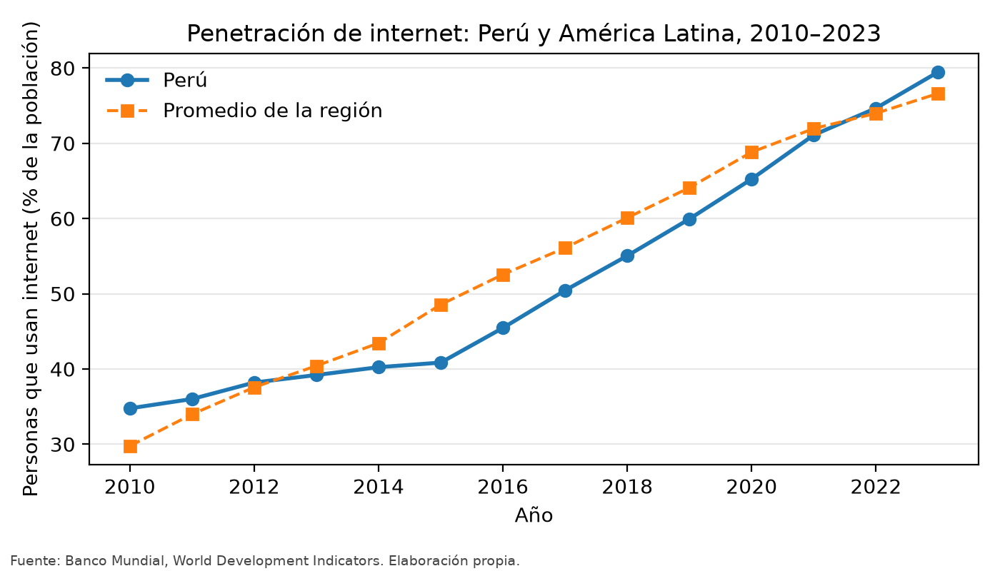
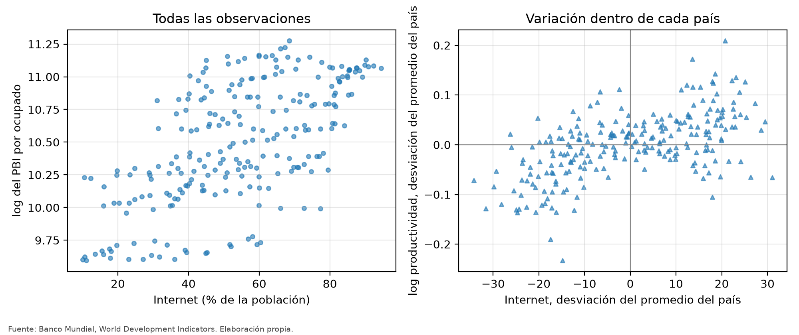
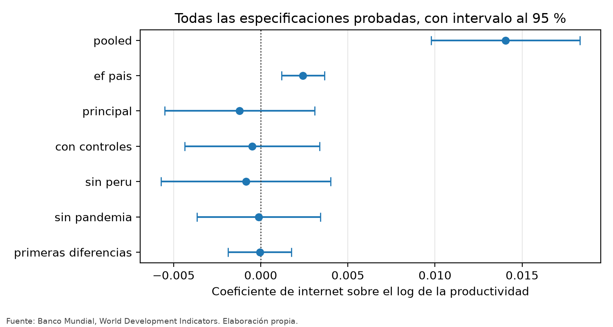

```{python}
#| echo: false
#| output: false
import json
import pathlib

import pandas as pd
from IPython.display import Markdown

R = pathlib.Path("resultados")
contexto = json.loads((R / "contexto.json").read_text(encoding="utf8"))
est = json.loads((R / "estimaciones.json").read_text(encoding="utf8"))
resumen = est["resumen"]
clave = resumen["comparacion_clave"]
esp = est["especificaciones"]
tabla = pd.read_csv(R / "tabla_estimaciones.csv")
comp = pd.read_csv(R / "peru_vs_region.csv")
correlaciones = pd.read_csv(R / "correlaciones.csv", index_col=0)


def c(spec, campo="coeficiente", dec=5):
    return f"{esp[spec][campo]:.{dec}f}"
```

# Resultados

## Presentación y análisis de los resultados

### Evolución de las dos series

La penetración de internet creció en todos los países de la muestra. En el Perú
pasó de `{python} f"{contexto['internet_peru_inicio']:.1f}"` % en
`{python} str(contexto['desde'])` a
`{python} f"{contexto['internet_peru_final']:.1f}"` % en
`{python} str(contexto['hasta'])`, una trayectoria muy parecida a la del promedio
regional.

{#fig-internet width=90%}

La correlación simple entre penetración de internet y logaritmo de la
productividad en el conjunto del panel es de
`{python} f"{correlaciones.loc['internet', 'productividad']:.3f}"` con la
productividad en niveles. Es una correlación alta, y es el punto de partida de
lo que sigue, no un resultado.

### De la correlación a la variación interna

La @fig-dispersion muestra por qué la correlación simple no basta. El panel
izquierdo cruza todas las observaciones país-año: la nube tiene pendiente
positiva clara. El panel derecho cruza las mismas variables expresadas como
desviación del promedio de cada país, es decir, usando solo la variación temporal
interna. La pendiente desaparece.

{#fig-dispersion width=100%}

### Estimaciones

```{python}
#| echo: false
#| label: tbl-estimaciones
#| tbl-cap: "Asociación entre penetración de internet y log de la productividad laboral. Errores estándar agrupados por país."
vista = tabla.copy()
vista.columns = ["Especificación", "Coeficiente", "Error estándar", "p", "n", "R²"]
vista["Especificación"] = vista["Especificación"].str.replace("_", " ")
Markdown(vista.to_markdown(index=False, floatfmt=(".0f", ".5f", ".5f", ".4f", ".0f", ".4f")))
```

La correlación simple, sin controles, da un coeficiente de
`{python} c('pooled')` con p = `{python} c('pooled', 'p', 4)`: un punto
porcentual más de penetración se asocia con
`{python} f"{esp['pooled']['coeficiente'] * 100:.2f}"` % más de producto por
ocupado. Al incorporar efectos fijos de país el coeficiente cae a
`{python} c('ef_pais')`, un orden de magnitud menos, y sigue siendo
significativo.

Al incorporar además efectos fijos de año —la especificación principal— el
coeficiente es `{python} c('principal')`, con error estándar
`{python} c('principal', 'error_estandar')` y p =
`{python} c('principal', 'p', 4)`. El intervalo de confianza al 95 % va de
`{python} c('principal', 'ic_bajo')` a `{python} c('principal', 'ic_alto')`, de
modo que incluye el cero. El coeficiente cambia de signo respecto de la
correlación simple y deja de ser distinto de cero.

### Robustez

```{python}
#| echo: false
#| output: asis
lineas = []
for nombre, e in esp.items():
    if nombre in ("pooled", "ef_pais", "principal"):
        continue
    lineas.append(
        f"- **{nombre.replace('_', ' ').capitalize()}**: coeficiente "
        f"{e['coeficiente']:.5f} (ee {e['error_estandar']:.5f}, "
        f"p {e['p']:.4f}, n {e['n']}). {e['por_que']}")
print("\n".join(lineas))
```

{#fig-robustez width=90%}

De las `{python} str(resumen['especificaciones_probadas'])` especificaciones
estimadas, `{python} str(resumen['especificaciones_significativas_al_5'])` son
significativas al 5 %, y son precisamente las dos que no incluyen efectos fijos
de año. Ninguna de las especificaciones que los incluyen produce un coeficiente
distinto de cero, y en todas ellas el signo es negativo y la magnitud
despreciable.

El resultado no depende del Perú: excluirlo deja el coeficiente en
`{python} c('sin_peru')`. No depende de la pandemia: restringir la muestra hasta
2019 lo deja en `{python} c('sin_pandemia')` con
`{python} str(esp['sin_pandemia']['n'])` observaciones. No depende de la forma
funcional: en primeras diferencias es `{python} c('primeras_diferencias')`.

### Síntesis de las hipótesis específicas

| Hipótesis | Resultado |
|---|---|
| 1. Asociación positiva y significativa sin controles | **Se sostiene** (`{python} c('pooled')`, p < 0.001) |
| 2. Se mantiene con efectos fijos de país y año | **No se sostiene** (`{python} c('principal')`, p = `{python} c('principal', 'p', 2)`) |
| 3. El resultado es estable ante cambios de muestra y especificación | **Se sostiene**: el coeficiente sigue siendo indistinguible de cero en las cuatro alternativas |

La hipótesis general, tal como fue formulada en el capítulo III, **no se
sostiene** con estos datos.
